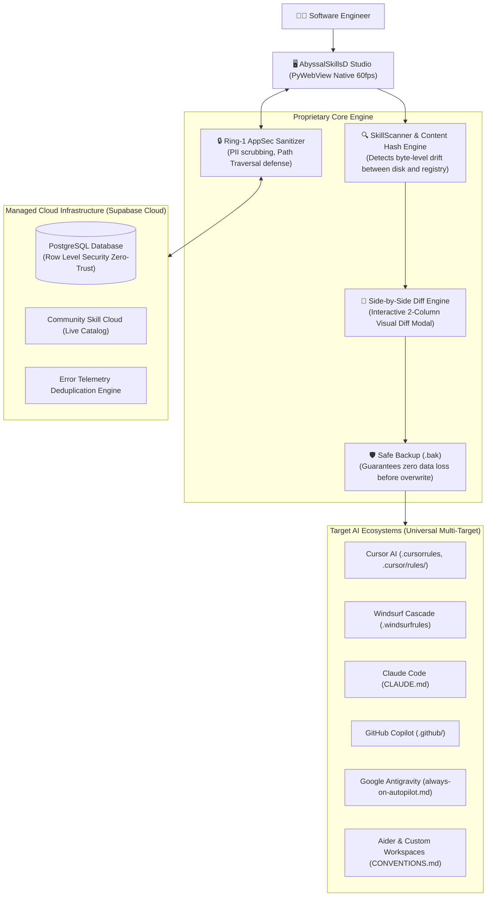

<p align="center">
  <b>English</b> •
  <a href="README.vi.md">Tiếng Việt</a>
</p>

<p align="center">
  
</p>

<h1 align="center">🌌 AbyssalSkillsD</h1>

<p align="center">
  <strong>The Definitive Local-First AI Skill Manager & Engineering Studio for Modern Software Teams</strong><br>
  <em>One unified engine to author, version, test, and deploy 36+ production-grade AI skills across Cursor AI, Windsurf, Claude Code, GitHub Copilot, Google Antigravity, and Aider.</em>
</p>

<p align="center">
  <a href="dist/AbyssalSkillsD-Setup-v1.0.0.exe"></a>
  <a href="dist/AbyssalSkillsD-v1.0.0-Portable.zip"></a>
  <a href="#-automated-verification-suite-25-quality-gates"></a>
  <a href="#-supabase-cloud-backend--zero-trust-telemetry"></a>
  
  
  
</p>

<p align="center">
  <a href="#-quick-install-in-30-seconds">Quick Install</a> •
  <a href="#-the-problem--the-breakthrough-solution">Why AbyssalSkillsD</a> •
  <a href="#-core-architecture--capabilities">Core Architecture</a> •
  <a href="#-the-36-curated-production-skills-suite">36 Skills Suite</a> •
  <a href="#-feature-comparison-matrix">Feature Comparison</a> •
  <a href="#-developer-guide">Developer Guide</a> •
  <a href="#-roadmap">Roadmap</a>
</p>

---

## ⚡ QUICK INSTALL IN 30 SECONDS

Zero runtime setup required. Pick your operating system below:

### 🖥️ 1. Windows (PowerShell or 1-Click GUI)

**Terminal 1-Liner (PowerShell):**
```powershell
# Auto-install Windows Setup Wizard:
powershell -ExecutionPolicy Bypass -Command "irm https://raw.githubusercontent.com/Play-with-me/AbyssalSkills-AI/main/scripts/install.ps1 | iex"

# Or install Portable Edition directly:
powershell -ExecutionPolicy Bypass -Command "& ([scriptblock]::Create((irm https://raw.githubusercontent.com/Play-with-me/AbyssalSkills-AI/main/scripts/install.ps1))) -Portable"
```

**Direct GUI Downloads:**
| Release Package | Size | Highlights | Direct Download |
| :--- | :---: | :--- | :---: |
| **Windows Setup (.exe)**<br>*(Recommended)* | **16.99 MB** | • 1-Click auto-install with Desktop & Start Menu shortcuts<br>• Clean uninstaller in Windows Settings<br>• Zero Python, Git, or Node.js required (Bundled WebView2) | [⬇️ **DOWNLOAD SETUP.EXE**](https://github.com/Play-with-me/AbyssalSkills-AI/raw/main/dist/AbyssalSkillsD-Setup-v1.0.0.exe) |
| **Portable Package (.zip)** | **22.41 MB** | • No Administrator privileges required<br>• Extract and run immediately via `AbyssalSkillsD.exe`<br>• Ideal for USB drives or enterprise laptops | [📦 **DOWNLOAD PORTABLE.ZIP**](https://github.com/Play-with-me/AbyssalSkills-AI/raw/main/dist/AbyssalSkillsD-v1.0.0-Portable.zip) |

#### 📖 Detailed Installation Instructions:

- **Method A: Windows Setup Installer (.exe) — Recommended**
  1. Click [**DOWNLOAD SETUP.EXE**](https://github.com/Play-with-me/AbyssalSkills-AI/raw/main/dist/AbyssalSkillsD-Setup-v1.0.0.exe) above to download the installer directly.
  2. Double-click `AbyssalSkillsD-Setup-v1.0.0.exe` to run the setup wizard.
  3. Click **Next** -> **Install**. The installer automatically configures the application and creates an `AbyssalSkillsD` shortcut on your Desktop and Start Menu.
  4. Launch the app from the Desktop icon or Start Menu.

- **Method B: Portable ZIP Package (.zip) — No Installation Required**
  1. Click [**DOWNLOAD PORTABLE.ZIP**](https://github.com/Play-with-me/AbyssalSkills-AI/raw/main/dist/AbyssalSkillsD-v1.0.0-Portable.zip) above to download the portable archive.
  2. Right-click the downloaded `.zip` file -> Select **Extract All...** to any location (e.g. `Desktop`, `D:\Apps`, or a USB flash drive).
  3. Open the extracted folder and double-click `AbyssalSkillsD.exe` to run immediately without admin rights.

---

### 🍎 2. macOS (Apple Silicon M-Series & Intel)

**Terminal 1-Liner (Terminal / zsh):**
```bash
curl -fsSL https://raw.githubusercontent.com/Play-with-me/AbyssalSkills-AI/main/scripts/install.sh | bash
```
*Downloads, sets up dependencies in isolated sandbox, configures native macOS Apple WebKit (WKWebView), and deploys the `abyssalskillsd` launcher command.*

---

### 🐧 3. Linux (Ubuntu, Debian, Fedora, Arch)

**Terminal 1-Liner (Bash):**
```bash
curl -fsSL https://raw.githubusercontent.com/Play-with-me/AbyssalSkills-AI/main/scripts/install.sh | bash
```
*Configures WebKitGTK engine, deploys `abyssalskillsd` shell launcher into `~/.local/bin/`, and automatically registers `abyssalskillsd.desktop` into your Linux Application Menu.*

---

### 🛠️ 4. Run from Source (Cross-Platform Developer Mode)
Requires **Python 3.12+** and Astral **`uv`**:

```bash
# Clone the repository
git clone https://github.com/Play-with-me/AbyssalSkills-AI.git
cd AbyssalSkills-AI

# Sync dependencies and launch
uv sync
uv run main.py
```

---

## 🎯 THE PROBLEM & THE BREAKTHROUGH SOLUTION

### The Pain Point for Modern AI Developers:
1. **Multi-IDE Rule Fragmentation:** Every coding assistant expects rules in a different directory with a proprietary dialect (`.cursorrules`, `.windsurfrules`, `CLAUDE.md`, `.github/copilot-instructions.md`, `always-on-autopilot.md`). Copy-pasting prompts across dozens of projects leads to drift, stale prompts, and wasted hours.
2. **The Silent Overwrite Catastrophe:** You spend hours fine-tuning an AI skill for your team's code conventions. An upstream update arrives; a blind `git pull` or batch-activation script **silently wipes out your customizations without warning**.
3. **PII & Secret Leaks:** Sharing prompts or error reports frequently leaks local Windows usernames (`C:\Users\username\...`), uncommitted tokens, or production API keys into AI logs.

### The AbyssalSkillsD Solution:
- ✅ **Universal Multi-Target Sync:** 1-Click simultaneously compiles and injects prompt rules into Cursor, Windsurf, Claude Code, GitHub Copilot, Google Antigravity, and Aider.
- ✅ **Zero Silent Overwrites:** Clean separation between brand-new skills and updated skills. An interactive **Side-by-Side Diff Engine** lets you review changes line-by-line, keep your local version, or accept updates with automatic `.bak` snapshot backups.
- ✅ **Ring-1 AppSec Sanitization:** Automatically scrubs 100% of PII, Windows hostpaths, and secrets before telemetry or diagnostic export.
- ✅ **Supabase PostgreSQL Cloud:** Built-in community marketplace and anti-flood error telemetry powered by cryptographic SHA-256 fingerprint deduplication.

---

## 🌌 CORE ARCHITECTURE & CAPABILITIES



---

### 1. Smart 2-Flow Activation & Interactive Side-by-Side Diff
Never face blind overwrites again. The executive toolbar dynamically reflects 3 distinct operational states:

```text
┌─────────────────────────────────────────────────────────────────────────────────┐
│ [⚡ Activate 7 New Skills]  │  [🔄 2 Skills Need Update Review]  │  [✓ In Sync]   │
└─────────────────────────────────────────────────────────────────────────────────┘
```

Clicking an update badge opens the **Side-by-Side Diff Review Modal**:
```text
┌──────────────────────────────────────┬──────────────────────────────────────┐
│  LOCAL DISK (YOUR CUSTOM VERSION)    │  UPSTREAM REGISTRY (NEW VERSION)     │
├──────────────────────────────────────┼──────────────────────────────────────┤
│  # Strict Architect Coder            │  # Strict Architect Coder            │
│  - Team Convention: Use pnpm         │  - New Feature: Added Gate 25 Tests  │
│  - Custom rule: Always add JSDoc     │  - Upstream fix: Anti-Overflow CSS   │
├──────────────────────────────────────┴──────────────────────────────────────┤
│  [ 🛡️ Keep My Local Version ]                 [ ⚡ Accept Update (.bak) ]    │
└─────────────────────────────────────────────────────────────────────────────┘
```

---

### 2. Universal Multi-Target Matrix

| AI Environment | Generated Files & Formats | Specification Standard |
| :--- | :--- | :--- |
| **Cursor AI** | `.cursorrules`<br>`.cursor/rules/always-on-autopilot.mdc` | Semantic XML Tags, Frontmatter Glob Matchers, Cursor Tab Autopilot |
| **Windsurf Cascade** | `.windsurfrules` | Cascade Flow Directives, Non-Interactive Safe Execution Mode |
| **Claude Code** | `CLAUDE.md` | Single-File Project Constitution & Subagent Delegation Directives |
| **GitHub Copilot** | `.github/copilot-instructions.md` | Repository Context Grounding, Language-Specific Guidelines |
| **Google Antigravity** | `always-on-autopilot.md`<br>`GEMINI.md` | Strict Dual-Layer Planning, Graphify AST Watchdog, Sub-Agents |
| **Aider & Custom IDE** | `CONVENTIONS.md`<br>`AGENTS.md` | Markdown Standards, Red-Green-Refactor Architecture |

---

### 3. Supabase Cloud Backend & Zero-Trust Telemetry
AbyssalSkillsD connects directly to **Supabase Managed PostgreSQL** with military-grade application security:
- **Zero-Trust Row Level Security (RLS):** Anonymous desktop clients are restricted to `INSERT` only for error reporting and cannot `SELECT` or inspect telemetry rows submitted by other developers.
- **Cryptographic Error Deduplication:** System crashes are hashed via SHA-256 (`fingerprint` over `error_type + module + line_number`). Repeated errors increment an internal counter (`occurrences: +1`), preventing telemetry spamming and network flooding.
- **Ring-1 PII Scrubbing:** Host machine paths (`C:\Users\<user>\...`), JWT session tokens, GitHub PATs, and passwords are permanently redacted before payload transmission.

---

## 📚 THE 36 CURATED PRODUCTION SKILLS SUITE

Every skill in the library is meticulously engineered, battle-tested in real production workflows, and bundled with exhaustive Markdown reference playbooks:

### Suite 1: Skill-AI Nucleus (7 Master Skills)
| Skill Identifier | Core Functionality | When to Use? |
| :--- | :--- | :--- |
| **`strict-architect-coder`** | Dual-Layer planning (Client-First + AI Spec), Graphify AST coordinator, zero-hallucination guardrail. | Complex feature planning, surgical refactoring, systematic root-cause debugging. |
| **`ui-ux-design-master`** | 16-in-1 Design Master, 118 Anti-Slop rules, sub-250ms physics motion, Anti-Overflow CSS (`min-h-0`). | Screen layouts, responsive components, typography, design systems. |
| **`shadcn-tailwind-artisan`** | Shadcn/ui craftsmanship, Tailwind CSS v4, accessible Radix Primitives. | Forms, dialogs, bento grids, accessible tables, navigation bars. |
| **`web-assets-creative-vault`** | Official SVG vector icon library (Lucide, Simple Icons), unDraw illustrations. | Embedding crisp vector logos, brand assets, and modern illustrations. |
| **`nextjs-fullstack-master`** | Next.js App Router, React 19 RSC, Server Actions, waterfall elimination. | Production full-stack TypeScript web applications on Vercel. |
| **`supabase-backend-architect`** | PostgreSQL schema design, Row Level Security (RLS) policies, Next.js SSR auth. | Database migrations, backend security policies, storage buckets. |
| **`playwright-web-tester`** | Automated End-to-End (E2E) test design, visual regression, cross-viewport verification. | Browser automation, user flow verification, CI/CD visual regression gates. |

### Suite 2: Addy Osmani Production Engineering Suite (29 Skills & Personas)
Full attribution to **Addy Osmani** (Google Engineering Lead), categorized across key disciplines:
- **Architecture & Scaffolding:** `api-and-interface-design`, `spec-driven-development`, `context-engineering`, `idea-refine`, `planning-and-task-breakdown`, `source-driven-development`, `deprecation-and-migration`.
- **Quality, Review & Testing:** `autonomous-task-verifier`, `test-driven-development`, `code-review-and-quality`, `code-reviewer`, `test-engineer`, `code-simplification`, `doubt-driven-development`.
- **Security, Performance & Operations:** `security-and-hardening`, `security-auditor`, `web-performance-auditor`, `performance-optimization`, `observability-and-instrumentation`, `ci-cd-and-automation`, `shipping-and-launch`.

---

## 📊 FEATURE COMPARISON MATRIX

| Evaluation Criteria | Manual Copy-Paste | Ad-Hoc Scripts | **AbyssalSkillsD v1.0.0** |
| :--- | :---: | :---: | :---: |
| **Visual Desktop Studio (GUI)** | ❌ None | ❌ None | **✅ Yes (Dark Glassmorphic 60fps)** |
| **Simultaneous Multi-AI Sync** | ❌ Manual per-file edit | ⚠️ 1-2 targets only | **✅ 6 Major AI Environments** |
| **Content Drift / Hash Detection** | ❌ None | ❌ None | **✅ MD5/SHA-256 Per-File Hashes** |
| **Visual Side-by-Side Diff Review** | ❌ Unintentional overwrite | ❌ Blind overwrite | **✅ Interactive 2-Column Diff Modal** |
| **Automatic Snapshot Backup (.bak)** | ❌ Dependent on memory | ❌ None | **✅ 100% Automatic** |
| **PII & Secret Sanitization** | ❌ Frequent token leaks | ❌ None | **✅ Ring-1 AppSec Sanitizer** |
| **Live Cloud Marketplace** | ❌ None | ❌ None | **✅ Supabase PostgreSQL Cloud** |
| **Anti-Spam Telemetry Deduplication** | ❌ None | ❌ None | **✅ SHA-256 Error Deduplication** |
| **Zero-Dependency Runtime** | ❌ Needs Python/Node | ⚠️ Needs script runtime | **✅ Bundled Native Windows (.exe)** |

---

## 🧪 AUTOMATED VERIFICATION SUITE (25 QUALITY GATES)

Every change in AbyssalSkillsD is guarded by a comprehensive 25-gate automated verification suite:

```powershell
uv run python tests/test_verification.py
```

<details>
<summary><strong>Click to expand the 25 Automated Quality Gates (All Green)</strong></summary>

- `Gate 1 -> 7`: Integrity and playbook verification for 7 Skill-AI Nucleus Master Skills.
- `Gate 8`: Verification of 237 in-depth technical reference documents.
- `Gate 9`: Multi-target batch installation and rules scaffolding generator.
- `Gate 10`: Supabase Community Cloud PostgreSQL schema & RLS policy audit.
- `Gate 11`: Graphify AST code graph analysis (Internal AI watchdog).
- `Gate 12`: Dual-theme design tokens & accessibility attributes (WAI-ARIA).
- `Gate 13`: 3 Persistent Project Memory Anchors (`PROJECT_MEMORY.md`, `GRAPH_REPORT.md`, `DESIGN.md`).
- `Gate 14`: Onboarding 3-step banner, when_to_use triggers, and starter prompts.
- `Gate 15`: 1-Click Google & GitHub social auth simulation & progressive workbench.
- `Gate 16`: 29 Addy Osmani skills & personas with 100% transparent attribution.
- `Gate 17`: Cinematic assembly intro animation with smooth zoom-through transition.
- `Gate 18`: Addy Osmani Standard Studio authoring workbench.
- `Gate 19`: Standalone PyInstaller onedir distribution packaging integrity.
- `Gate 20`: Neural stream activation animation & 1-click live verification proof.
- `Gate 21`: Clean teardown / uninstall engine, safe `.bak` backups, and dynamic workspaces.
- `Gate 22`: 1-Click Multi-AI Global Sync & Project Rules Scaffolding generator.
- `Gate 23`: Live Community Cloud Hub, Diagnostic Logger in `%LOCALAPPDATA%`.
- `Gate 24`: Zero-Trust Security, Ring-1 PII Sanitizer & SHA-256 Error Deduplication Engine.
- `Gate 25`: Anti-Overflow Layout Safety CSS, 2-Flow Smart Activation & Side-by-Side Diff Engine.

</details>

---

## 🛠️ DEVELOPER GUIDE

### Directory Anatomy:
```text
AbyssalSkills-AI/
├── app/
│   ├── backend/           # Python engine (API, Auth, Scanner, Storage, Installer)
│   ├── data/              # Bundled Skills Registry, SQL Schema, Supabase config
│   └── frontend/          # Modern Glassmorphic UI (HTML5, CSS, Vanilla JS)
├── dist/                  # Production builds (Setup.exe, Portable.zip)
├── graphify-out/          # Graphify AST Knowledge Graph (11,000+ nodes)
├── installer/             # Inno Setup 6 packaging script (.iss)
├── scripts/               # Distribution packager & 1-line install scripts
└── tests/                 # 25-Gate Automated Verification Suite
```

### Packaging & Release Pipeline:
```powershell
# Step 1: Package Standalone PyInstaller onedir and Portable ZIP
uv run python scripts/build_distribution.py

# Step 2: Compile the single-file Windows installer via Inno Setup 6
& "C:\Users\<user>\AppData\Local\Programs\Inno Setup 6\ISCC.exe" "installer\abyssalskillsd.iss"
```

---

## 🗺️ ROADMAP

- [x] **v1.0.0 (Current):** Standalone Windows installer, 36 production skills, Smart 2-Flow Activation, Side-by-Side Diff, Supabase Cloud backend, Portable ZIP.
- [ ] **v1.1.0:** Cross-platform native support for macOS (Apple Silicon) & Linux.
- [ ] **v1.2.0:** Official VS Code / Cursor IDE Extension.
- [ ] **v1.3.0:** AbyssalSkills Headless CLI (`abyssal install <skill>`).
- [ ] **v2.0.0:** Enterprise Team Sync with private organization skill vaults.

---

## 📄 LICENSE & CREDITS

- **Lead Architect:** **[Kyuu4](https://github.com/kyuu4)**.
- **Brand System:** Abyssal Sky v2.0 motif and visual design system are proprietary to AbyssalSkills.
- **Intellectual Attribution:** Sincere gratitude to **Addy Osmani** and the open-source engineering community for foundational contributions to modern AI developer tooling.

<p align="center">
  <sub>Built with precision for the era of AI-native software engineering. If you find AbyssalSkillsD valuable, please leave a ⭐️ Star on GitHub!</sub>
</p>
