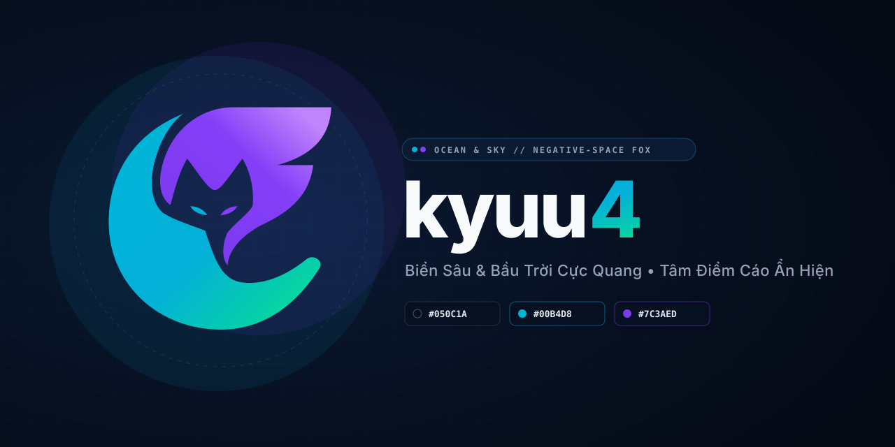
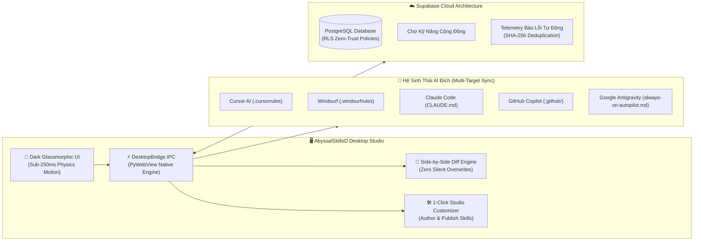

<p align="center">
  
</p>

<p align="center">
  <strong>Hệ Thống Quản Trị Kỹ Năng AI Tự Động & Chợ Tri Thức Chuyên Sâu Chuẩn Doanh Nghiệp</strong><br>
  <em>Tương thích toàn diện với Cursor AI, Windsurf, Claude Code, GitHub Copilot, Google Antigravity và Aider</em>
</p>

<p align="center">
  <a href="dist/AbyssalSkillsD-Setup-v1.0.0.exe"></a>
  <a href="dist/AbyssalSkillsD-v1.0.0-Portable.zip"></a>
  
  
  
</p>

---

## ⚡ CÀI ĐẶT NHANH (1-CLICK INSTALLATION)

Bạn có thể tải về và cài đặt trực tiếp **AbyssalSkillsD** ngay từ tài liệu này qua các cách sau:

### 🌟 Cách 1: Tải Bản Cài Đặt Tự Động (Khuyên Dùng Cho Người Dùng Cuối)

| Phương thức tải | Dung lượng | Tác vụ tự động | Liên kết tải trực tiếp |
| :--- | :---: | :--- | :---: |
| **Windows Setup (.exe)** | **16.95 MB** | • Cài đặt 1-Click vào máy tính<br>• Tự tạo icon trên Desktop & Start Menu<br>• Tích hợp Uninstaller trong Windows Settings<br>• Tích hợp sẵn WebView2 (Zero Python/Git required) | [⬇️ **TẢI SETUP.EXE**](dist/AbyssalSkillsD-Setup-v1.0.0.exe?raw=true) |
| **Portable Package (.zip)** | **22.33 MB** | • Không cần quyền Admin<br>• Giải nén và chạy ngay qua `AbyssalSkillsD.exe`<br>• Thích hợp lưu trữ trên USB hoặc máy công ty | [📦 **TẢI PORTABLE.ZIP**](dist/AbyssalSkillsD-v1.0.0-Portable.zip?raw=true) |

---

### 💻 Cách 2: Cài Đặt Tức Thì Bằng 1 Dòng Lệnh PowerShell (Dành Cho Lập Trình Viên)

Mở **PowerShell** trên Windows và dán dòng lệnh bên dưới:

```powershell
# Tải và khởi động trình cài đặt AbyssalSkillsD tự động (1-Liner PowerShell):
Invoke-WebRequest -Uri "https://github.com/Play-with-me/AbyssalSkills-AI/raw/main/dist/AbyssalSkillsD-Setup-v1.0.0.exe" -OutFile "$env:TEMP\AbyssalSkillsD-Setup-v1.0.0.exe"; Start-Process "$env:TEMP\AbyssalSkillsD-Setup-v1.0.0.exe"
```

---

### 🛠️ Cách 3: Khởi Chạy Trực Tiếp Từ Mã Nguồn (Dành Cho Đóng Góp Mã Nguồn)

Yêu cầu máy đã cài **Python 3.12+** và công cụ quản lý gói **`uv`**:

```powershell
# 1. Clone kho lưu trữ về máy
git clone https://github.com/Play-with-me/AbyssalSkills-AI.git
cd AbyssalSkills-AI

# 2. Cài đặt toàn bộ thư viện cần thiết
uv sync

# 3. Khởi chạy ứng dụng Desktop
uv run main.py
```

---

## 🌌 TỔNG QUAN KIẾN TRÚC & ĐẶC TÍNH NỔI BẬT



---

## ✨ 5 TRỤ CỘT ĐỘT PHÁ CỦA ABYSSALSKILLSD

### 1. Kích Hoạt Nhanh Thông Minh (Zero Silent Overwrites)
- **Tách biệt 2 luồng độc lập:**
  - `⚡ Kích Hoạt N Kỹ Năng Mới`: Chỉ cài đặt các kỹ năng chưa từng nạp vào máy, không chạm vào kỹ năng đã có.
  - `🔄 Có K Kỹ Năng Cần Cập Nhật`: Hiển thị Popup So Sánh 2 Cột (Side-by-Side Diff).
- **Quyền tự quyết của lập trình viên:** Bạn có toàn quyền chọn **`[Giữ Lại Bản Cũ Của Tôi]`** để bảo vệ công sức chỉnh sửa cá nhân, hoặc **`[Đồng Ý Cập Nhật]`** với cơ chế tự động tạo tệp sao lưu an toàn (`SKILL.md.bak`).
- **Trạng thái sẵn sàng hoàn mỹ:** Khi toàn bộ 36 kỹ năng đã đồng bộ, nút kích hoạt chuyển sang màu xanh ngọc bích **`✓ Đã Kích Hoạt Đầy Đủ (36/36)`**.

### 2. Bộ 36 Kỹ Năng Tinh Hoa Tích Hợp Sẵn (100% Attribution)
- **Skill-AI Nucleus Suite (7 Kỹ Năng Nền Tảng):**
  1. `strict-architect-coder`: Lập kế hoạch 2 lớp (Client + AI Spec), chống ảo giác kỹ thuật.
  2. `ui-ux-design-master`: Thiết kế giao diện đỉnh cao, 118 quy tắc Anti-Slop, chống tràn CSS.
  3. `shadcn-tailwind-artisan`: Chế tác linh kiện Shadcn/ui và Tailwind CSS v4 chuẩn mực.
  4. `web-assets-creative-vault`: Kho vector SVG Lucide, Simple Icons và minh họa unDraw.
  5. `nextjs-fullstack-master`: Kiến trúc Next.js App Router, Server Actions và triệt tiêu Waterfall.
  6. `supabase-backend-architect`: Thiết kế cơ sở dữ liệu PostgreSQL, phân quyền RLS an toàn tuyệt đối.
  7. `playwright-web-tester`: Bộ kiểm thử tự động End-to-End, chống lỗi hồi quy giao diện.
- **Addy Osmani Production Engineering Suite (29 Kỹ Năng & Chuyên Gia Persona):**
  - Bao gồm `frontend-ui-engineering`, `security-and-hardening`, `test-driven-development`, `performance-optimization`, `code-reviewer`, `api-and-interface-design`, `doubt-driven-development`, `context-engineering`... được trích dẫn nguồn minh bạch.

### 3. Đồng Bộ Đa Trợ Lý AI Trong 1 Click (Universal Multi-AI Sync)
- Tự động sinh trọn bộ tệp cấu hình chuyên dụng cho từng môi trường:
  - `.cursorrules` & `.cursor/rules/always-on-autopilot.mdc` cho **Cursor AI**.
  - `.windsurfrules` cho **Windsurf Cascade**.
  - `CLAUDE.md` cho **Claude Code**.
  - `.github/copilot-instructions.md` cho **GitHub Copilot**.
  - `always-on-autopilot.md` cho **Google Antigravity**.

### 4. Đám Mây Supabase Cloud & Telemetry Tự Động Báo Lỗi
- **Kết nối cơ sở dữ liệu PostgreSQL trực tiếp:** Tra cứu, đánh giá sao, và cài đặt các kỹ năng chia sẻ từ cộng đồng lập trình viên toàn cầu.
- **Chẩn đoán & Thu thập lỗi an toàn (Zero-Trust):** 
  - Tự động làm sạch dữ liệu nhạy cảm (`sanitize_sensitive_data`), xóa sổ tên tài khoản Windows, khóa API và JWT token trước khi gửi đi.
  - Thuật toán băm mã lỗi SHA-256 (`fingerprint`) gom nhóm các lỗi trùng lặp, chống spam click và hỗ trợ đội ngũ phát triển khắc phục sự cố tức thì.

### 5. Nhận Diện Thương Hiệu Độc Quyền Abyssal Sky v2.0
- **Hình tượng nghệ thuật:** *Biển Trời Giao Hòa • Tâm Điểm Cáo Ẩn Hiện* (Kỹ thuật không gian âm Gestalt Negative-Space).
- **Bảng màu cảm hứng:** `#050C1A` (Vực Thẳm Vũ Trụ), `#00B4D8` (Sóng Biển Điện Tử), `#7C3AED` (Cực Quang Thiên Hà).
- **Trải nghiệm xúc giác:** Hoạt ảnh dòng hạt vi mạch (Neural Stream Stage), nút mở thư mục thực tế trên ổ cứng (`[📁 Mở Thư Mục]`), và khay câu lệnh mẫu kiểm chứng AI tức thì (`[🧪 Kiểm Chứng AI]`).

---

## 🧪 BỘ KIỂM THỬ TỰ ĐỘNG (25 CỔNG CHẤT LƯỢNG)

Để đảm bảo chất lượng phần mềm không bao giờ bị suy giảm (Zero-Regression), dự án được bảo vệ bởi bộ 25 cổng kiểm định tự động:

```powershell
# Chạy bộ kiểm thử toàn diện:
uv run python tests/test_verification.py
```

```text
▶ Running AbyssalSkillsD Comprehensive Verification Suite (25 Gates)...
  [PASS] Verified 7 Skill-AI Nucleus Master Skills & Playbooks.
  [PASS] Verified 29 Addy Osmani Production Engineering Suite Items.
  [PASS] Batch installation & Multi-Target Rules Deployment (.cursor, windsurf, copilot).
  [PASS] Supabase Community Schema verified with RLS & GIN Index.
  [PASS] Graphify AST analysis verified as internal AI watchdog.
  [PASS] Neural Stream Activation Animation & Live Verification Proof Engine.
  [PASS] Clean Teardown / Uninstall Engine & Automatic Snapshot Backup (.bak).
  [PASS] Anti-Spam Telemetry Deduplication & PII Scrubbing.
  [PASS] Anti-Overflow Layout Safety & Side-by-Side Diff Engine.
✅ ALL 25 VERIFICATION GATES PASSED!
```

---

## 📦 QUY TRÌNH ĐÓNG GÓI XUẤT XƯỞNG (BUILD PIPELINE)

Nếu bạn muốn tự tay biên dịch bộ cài đặt từ mã nguồn:

```powershell
# Bước 1: Đóng gói Standalone Onedir và tệp Portable ZIP
uv run python scripts/build_distribution.py

# Bước 2: Biên dịch tệp Setup Installer duy nhất qua Inno Setup 6
& "C:\Users\kyuu4\AppData\Local\Programs\Inno Setup 6\ISCC.exe" "installer\abyssalskillsd.iss"
```
Kết quả xuất xưởng sẽ nằm gọn trong thư mục `dist/`:
- `dist/AbyssalSkillsD-Setup-v1.0.0.exe` (Bộ cài đặt Windows)
- `dist/AbyssalSkillsD-v1.0.0-Portable.zip` (Bản nén di động)

---

## 👥 TÁC GIẢ & BẢN QUYỀN

- **Kiến trúc sư trưởng:** [Kyuu4](https://github.com/kyuu4) & Đội ngũ Sáng tạo AbyssalSkills.
- **Bản quyền thương hiệu:** Sở hữu độc quyền hình tượng biểu trưng *Abyssal Sky v2.0* và mã nguồn ứng dụng *AbyssalSkillsD*.
- **Giấy phép tri thức:** Các kỹ năng đóng góp từ Addy Osmani và cộng đồng mã nguồn mở tuân thủ giấy phép phân phối mở tương ứng với 100% trích dẫn minh bạch.

<p align="center">
  <sub>Được phát triển với niềm đam mê dành cho cộng đồng kỹ sư phần mềm AI.</sub>
</p>
