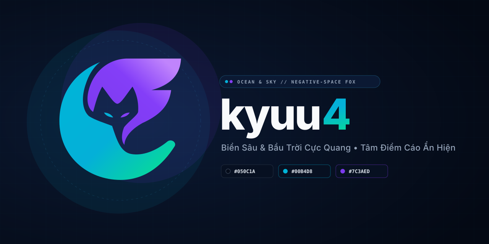

<p align="center"></p>

# AbyssalSkillsD

<p align="center">
  <a href="https://github.com/Play-with-me/AbyssalSkills-AI/releases/latest">
    
  </a>
  <a href="https://github.com/Play-with-me/AbyssalSkills-AI/actions">
    
  </a>
  
  
</p>

A Python/PyWebView desktop manager for AI skill files. Includes 36 verified library entries: 7 Skill-AI skills and 29 Addy Osmani entries (including four personas). Author: Lâm Nhựt Hải Đăng (Kyuu449977).

[Tiếng Việt](README.vi.md) · [Verification Evidence & Acceptance Report](docs/VERIFICATION-1.1.0.vi.md)

### Download & Quick Installation (Always Latest)
- **Windows Setup (Recommended):** [Download Latest Setup.exe](https://github.com/Play-with-me/AbyssalSkills-AI/releases/latest/download/AbyssalSkillsD-Setup.exe)
- **Portable Edition:** [Download Latest Portable.zip](https://github.com/Play-with-me/AbyssalSkills-AI/releases/latest/download/AbyssalSkillsD-Portable.zip)
- **1-Click PowerShell Install (Automatically fetches the latest version):**
  ```powershell
  irm https://raw.githubusercontent.com/Play-with-me/AbyssalSkills-AI/main/scripts/install.ps1 | iex
  ```

> [!NOTE]
> **Clean Uninstallation:** When uninstalled via Windows Settings or Control Panel, AbyssalSkillsD automatically purges 100% of temporary runtime configurations, cache, and logs (`%APPDATA%\AbyssalSkillsD` & `%LOCALAPPDATA%\AbyssalSkillsD`), leaving zero leftover data on your machine.

---

### Core Features

- **Local Library & Studio:** Search, favorite, create, and customize skills for 7 AI assistants (Antigravity, Claude, Cursor, Windsurf, Copilot, Codex, Aider).
- **Target Deployment & Rules:** Writes `SKILL.md`, reference files, and rule injections for target workspaces without touching existing custom instructions.
- **Precision File Diff & Rollback:** File-specific diff with stale-preview checks, immutable backups before replacement, and recoverable uninstall archives (`.abyssal-removed`).
- **Git Cache & Sync:** Isolated Git cache per repository URL with commit-based sync. Git is an external prerequisite; Graphify is optional and separately installed.
- **Community Cloud (Supabase):** Browse, paginate, publish, edit, rate, report, and filter community-contributed skills with Row-Level Security (RLS).
- **Secure Authentication:** Real GitHub PKCE OAuth flow with Windows Credential Manager token encryption. JavaScript never handles raw refresh tokens or administrator keys.
- **Diagnostics:** Explicit opt-in diagnostics with live preview, automated sensitive data sanitization, ZIP export, and idempotent reporting.

---

### Development & Verification

```powershell
uv sync --frozen --extra dev
uv run python tests/test_verification.py
uv run python main.py
```

Windows 10/11 x64 and Microsoft Edge WebView2 Runtime are required. Build distribution packages with:

```powershell
uv run python scripts/build_distribution.py
uv run python tests/check_distribution.py
```

Inno Setup 6 is used to compile `AbyssalSkillsD-Setup.exe` with silent clean-uninstall hooks. Packages exclude runtime logs, sessions, and Git caches.
