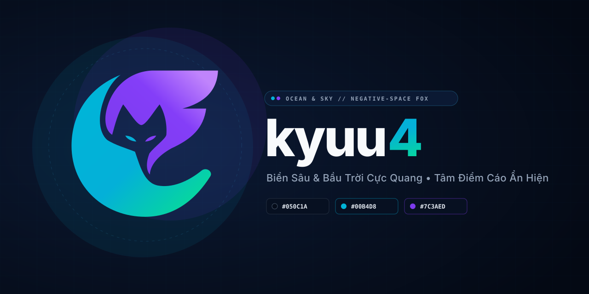

<p align="center"></p>

# AbyssalSkillsD

<p align="center">
  <a href="https://github.com/Play-with-me/AbyssalSkills-AI/releases/latest">
    
  </a>
  <a href="https://github.com/Play-with-me/AbyssalSkills-AI/actions">
    
  </a>
  
  
</p>

Trình quản lý tệp kỹ năng AI bằng Python/PyWebView dành riêng cho Windows. Tích hợp sẵn 36 mục kỹ năng bản quyền: 7 kỹ năng chuẩn Skill-AI và 29 mục từ Addy Osmani (bao gồm 4 persona). Tác giả: Lâm Nhựt Hải Đăng (Kyuu449977).

[English](README.md) · [Báo Cáo Nghiệm Thu & Kiểm Chứng Thực Nghiệm](docs/VERIFICATION-1.1.0.vi.md)

---

### Tải Về & Cài Đặt (Luôn Là Bản Mới Nhất)

- **Bản Cài Đặt Windows (.exe - Khuyên dùng):** [Tải Trực Tiếp Setup.exe Mới Nhất](https://github.com/Play-with-me/AbyssalSkills-AI/releases/latest/download/AbyssalSkillsD-Setup.exe)
- **Bản Di Động (Portable .zip - Không cần cài đặt):** [Tải Bản Portable.zip Mới Nhất](https://github.com/Play-with-me/AbyssalSkills-AI/releases/latest/download/AbyssalSkillsD-Portable.zip)
- **Cài đặt 1 dòng lệnh PowerShell (Tự động nhận diện và tải bản phát hành mới nhất):**
  ```powershell
  irm https://raw.githubusercontent.com/Play-with-me/AbyssalSkills-AI/main/scripts/install.ps1 | iex
  ```

> [!NOTE]
> **Tự Động Dọn Sạch Dữ Liệu Khi Gỡ Cài Đặt:** Khi bạn gỡ cài đặt ứng dụng qua Windows Settings hoặc Control Panel, hệ thống sẽ tự động dọn sạch 100% dữ liệu tạm, bộ nhớ đệm, tệp cấu hình và nhật ký (`%APPDATA%\AbyssalSkillsD` & `%LOCALAPPDATA%\AbyssalSkillsD`), đảm bảo không để lại bất kỳ tệp tin rác nào trên máy tính của bạn như các ứng dụng hiện đại.

---

## Tính Năng Cốt Lõi

- **Kho Kỹ Năng & Xưởng Chế Tác (Studio):** Tìm kiếm, đánh dấu yêu thích, tạo mới và tinh chỉnh kỹ năng cho 7 nền tảng AI (Antigravity, Claude, Cursor, Windsurf, Copilot, Codex, Aider).
- **Cài Đặt Đa Đích & Quy Tắc Rules:** Tự động ghi `SKILL.md`, tài liệu tham khảo reference và chèn khối quy tắc rules mà không làm mất hoặc ghi đè các chỉ dẫn riêng của bạn.
- **So Sánh Tệp (Diff) & Sao Lưu An Toàn:** Xem trước khác biệt từng dòng, chặn áp dụng nếu tệp nguồn bị sửa ngoài luồng, sao lưu tự động trước khi ghi đè, và lưu trữ bản gỡ cài đặt có thể phục hồi (`.abyssal-removed`).
- **Bộ Nhớ Đệm Git & Đồng Bộ Nguồn:** Phân vùng cache Git theo URL, kiểm tra commit gốc trước khi kéo bản mới. Cần có sẵn Git trên máy; Graphify là tùy chọn cài thêm.
- **Trung Tâm Đám Mây Cộng Đồng (Supabase):** Khám phá, phân trang, tải về, đăng bài, sửa bài, đánh giá và báo cáo kỹ năng với bảo mật phân quyền Row-Level Security (RLS).
- **Xác Thực An Toàn Chuẩn Doanh Nghiệp:** Đăng nhập GitHub PKCE OAuth thật, mã hóa lưu trữ token trong Windows Credential Manager. Giao diện JavaScript không bao giờ tiếp xúc với refresh token hay khóa quản trị.
- **Chẩn Đoán Thông Minh:** Kiểm tra trạng thái hệ thống, xem trước dữ liệu ẩn danh hóa trước khi gửi, xuất tệp chẩn đoán ZIP chỉ khi có sự đồng ý của người dùng.

---

## Phát Triển & Kiểm Thử

```powershell
uv sync --frozen --extra dev
uv run python tests/test_verification.py
uv run python main.py
```

Yêu cầu Windows 10/11 x64 và Microsoft Edge WebView2 Runtime. Đóng gói bộ cài đặt:

```powershell
uv run python scripts/build_distribution.py
uv run python tests/check_distribution.py
```

Sử dụng Inno Setup 6 để biên dịch `AbyssalSkillsD-Setup.exe` kèm hook gỡ cài đặt dọn sạch 100% dữ liệu. Gói phát hành tự động loại trừ toàn bộ nhật ký, phiên đăng nhập và cache tạm.
