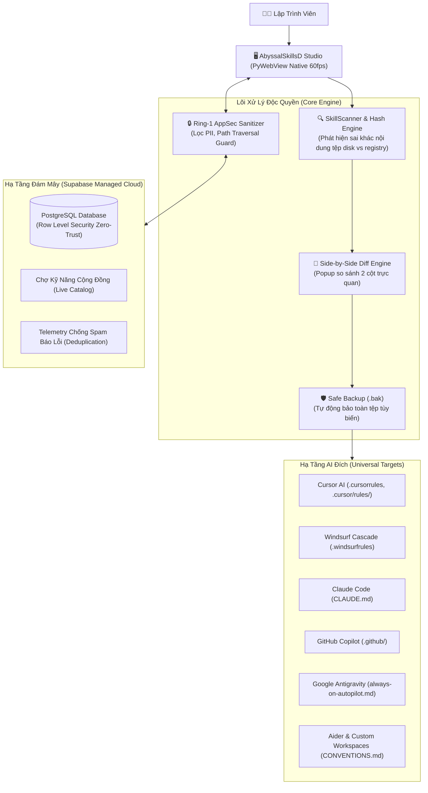

<p align="center">
  <a href="README.md">English</a> •
  <a href="README.vi.md"><b>Tiếng Việt</b></a>
</p>

<p align="center">
  
</p>

<h1 align="center">🌌 AbyssalSkillsD</h1>

<p align="center">
  <strong>Hệ Thống Quản Trị Kỹ Năng AI Tự Động & Chợ Tri Thức Chuyên Sâu Chuẩn Doanh Nghiệp</strong><br>
  <em>Một nền tảng duy nhất để tạo lập, đánh phiên bản, kiểm thử và triển khai 36+ kỹ năng AI kỹ thuật cao trên Cursor AI, Windsurf, Claude Code, GitHub Copilot, Google Antigravity và Aider.</em>
</p>

<p align="center">
  <a href="dist/AbyssalSkillsD-Setup-v1.0.0.exe"></a>
  <a href="dist/AbyssalSkillsD-v1.0.0-Portable.zip"></a>
  <a href="#-bộ-kiểm-thử-tự-động-25-cổng-chất-lượng"></a>
  <a href="#-kết-nối-đám-mây-supabase-cloud--zero-trust-telemetry"></a>
  
  
  
</p>

<p align="center">
  <a href="#-cài-đặt-ngay-trong-30-giây">Cài Đặt Nhanh</a> •
  <a href="#-vấn-đề-nhức-nhối--giải-pháp-đột-phá">Vấn Đề & Giải Pháp</a> •
  <a href="#-tính-năng-cốt-lõi-core-capabilities">Tính Năng Cốt Lõi</a> •
  <a href="#-danh-mục-36-kỹ-năng-tinh-hoa-curated-suite">Danh Mục 36 Kỹ Năng</a> •
  <a href="#-bảng-so-sánh-tính-năng">So Sánh Tính Năng</a> •
  <a href="#-hướng-dẫn-phát-triển-developer-guide">Dành Cho Devs</a> •
  <a href="#-lộ-trình-phát-triển-roadmap">Lộ Trình</a>
</p>

---

## ⚡ CÀI ĐẶT NGAY TRONG 30 GIÂY

Không cần cấu hình môi trường phức tạp. Chọn hệ điều hành của bạn dưới đây:

### 🖥️ 1. Windows (Lệnh PowerShell hoặc File Cài Đặt)

**Cài đặt 1 dòng lệnh siêu tốc (PowerShell):**
```powershell
# Cài đặt tự động bản Windows Setup Wizard:
powershell -ExecutionPolicy Bypass -Command "irm https://raw.githubusercontent.com/Play-with-me/AbyssalSkills-AI/main/scripts/install.ps1 | iex"

# Hoặc cài đặt tự động Bản Di Động Portable:
powershell -ExecutionPolicy Bypass -Command "& ([scriptblock]::Create((irm https://raw.githubusercontent.com/Play-with-me/AbyssalSkills-AI/main/scripts/install.ps1))) -Portable"
```

**Hoặc tải tệp cài đặt trực tiếp:**
| Bản Phát Hành | Dung Lượng | Điểm Nổi Bật | Tải Về Trực Tiếp |
| :--- | :---: | :--- | :---: |
| **Windows Setup (.exe)**<br>*(Khuyên dùng)* | **16.99 MB** | • 1-Click cài đặt tự động vào Windows<br>• Tự tạo biểu tượng trên Desktop & Start Menu<br>• Tích hợp trình gỡ cài đặt (Uninstaller) trong Settings<br>• Không cần cài Python, Git hay Node.js | [⬇️ **TẢI SETUP.EXE**](https://github.com/Play-with-me/AbyssalSkills-AI/raw/main/dist/AbyssalSkillsD-Setup-v1.0.0.exe) |
| **Bản Di Động Portable (.zip)** | **22.41 MB** | • Không cần quyền Administrator<br>• Giải nén và chạy ngay qua `AbyssalSkillsD.exe`<br>• Lý tưởng cho USB hoặc máy công ty | [📦 **TẢI PORTABLE.ZIP**](https://github.com/Play-with-me/AbyssalSkills-AI/raw/main/dist/AbyssalSkillsD-v1.0.0-Portable.zip) |

#### 📖 Hướng Dẫn Cài Đặt Chi Tiết Từng Bước:

- **Cách 1: Trình Cài Đặt Tự Động (Windows Setup .exe) — Khuyên Dùng**
  1. Bấm vào nút [**TẢI SETUP.EXE**](https://github.com/Play-with-me/AbyssalSkills-AI/raw/main/dist/AbyssalSkillsD-Setup-v1.0.0.exe) ở bảng trên để tải trực tiếp tệp cài đặt về máy.
  2. Nhấp đúp vào tệp `AbyssalSkillsD-Setup-v1.0.0.exe` để mở trình cài đặt -> Bấm **Next** -> Bấm **Install**.
  3. Trình cài đặt tự động thiết lập và tạo biểu tượng **AbyssalSkillsD** trên Desktop và Start Menu.
  4. Khởi chạy ứng dụng từ biểu tượng ngoài Desktop.

- **Cách 2: Bản Di Động Dùng Ngay (Portable .zip) — Không Cần Cài Đặt**
  1. Bấm vào nút [**TẢI PORTABLE.ZIP**](https://github.com/Play-with-me/AbyssalSkills-AI/raw/main/dist/AbyssalSkillsD-v1.0.0-Portable.zip) ở bảng trên để tải tệp nén di động.
  2. Chuột phải vào tệp `.zip` vừa tải -> Chọn **Extract All...** (Giải nén toàn bộ) vào thư mục bất kỳ (ví dụ: `Desktop`, `D:\Apps`, hoặc USB).
  3. Mở thư mục vừa giải nén -> Nhấp đúp vào `AbyssalSkillsD.exe` để mở ngay ứng dụng (không cần quyền Admin).

---

### 🍎 2. macOS (Apple Silicon M-Series & Intel)

**Cài đặt 1 dòng lệnh Terminal (zsh / bash):**
```bash
curl -fsSL https://raw.githubusercontent.com/Play-with-me/AbyssalSkills-AI/main/scripts/install.sh | bash
```
*Tự động tải mã nguồn, thiết lập môi trường cô lập, kích hoạt engine đồ họa gốc Apple WebKit (WKWebView), và tạo lệnh khởi chạy `abyssalskillsd` toàn hệ thống.*

---

### 🐧 3. Linux (Ubuntu, Debian, Fedora, Arch)

**Cài đặt 1 dòng lệnh Terminal (Bash):**
```bash
curl -fsSL https://raw.githubusercontent.com/Play-with-me/AbyssalSkills-AI/main/scripts/install.sh | bash
```
*Tự động cấu hình WebKitGTK, tạo lối tắt shell `abyssalskillsd` vào `~/.local/bin/`, và đăng ký biểu tượng `abyssalskillsd.desktop` vào Menu Ứng Dụng của Linux.*

---

### 🛠️ 4. Chạy Từ Mã Nguồn (Dành Cho Lập Trình Viên Đa Hệ)
Yêu cầu máy đã cài **Python 3.12+** và công cụ quản lý gói **`uv`**:

```bash
# Clone kho lưu trữ về máy
git clone https://github.com/Play-with-me/AbyssalSkills-AI.git
cd AbyssalSkills-AI

# Đồng bộ thư viện và khởi chạy
uv sync
uv run main.py
```

---

## 🎯 VẤN ĐỀ NHỨC NHỐI & GIẢI PHÁP ĐỘT PHÁ

### Nỗi Đau Của Lập Trình Viên AI Hiện Nay:
1. **Phân Mảnh Đa Môi Trường:** Mỗi IDE/Agent dùng một định dạng quy tắc khác nhau (`.cursorrules`, `.windsurfrules`, `CLAUDE.md`, `.github/copilot-instructions.md`, `always-on-autopilot.md`). Việc copy-paste thủ công giữa các dự án gây sai sót và mất hàng giờ đồng bộ.
2. **Thảm Họa Ghi Đè Âm Thầm (Silent Overwrites):** Bạn đã dày công sửa một kỹ năng để phù hợp với quy chuẩn dự án của công ty. Một bản cập nhật mới từ kho xuất hiện; nếu bấm update hoặc pull code, toàn bộ tùy biến của bạn sẽ **bị xóa sạch mà không có cảnh báo**.
3. **Mã Lỗi Tràn Lan & Rò Rỉ Bí Mật (PII Leakage):** Việc chia sẻ prompt hay báo lỗi thường vô tình đính kèm đường dẫn thư mục nhạy cảm (`C:\Users\username\...`), khóa API hoặc JWT token của cá nhân.

### Giải Pháp Từ AbyssalSkillsD:
- ✅ **Centralized Multi-AI Deployment:** 1 lần bấm, kích hoạt đồng loạt vào toàn bộ 6 môi trường AI lớn nhất thế giới.
- ✅ **Zero Silent Overwrites:** Tách biệt luồng kỹ năng mới và kỹ năng cập nhật. Cung cấp **Popup So Sánh 2 Bảng (Side-by-Side Diff)** trước khi ghi đè, kèm cơ chế tự động tạo bản sao lưu snapshot (`.bak`).
- ✅ **Ring-1 AppSec Defense:** Tự động thanh lọc 100% PII, tên tài khoản Windows, tokens trước khi đẩy dữ liệu hoặc xuất báo cáo.
- ✅ **Đám Mây Supabase PostgreSQL:** Kết nối Chợ Cộng Đồng thực tế và trung tâm Telemetry chống trùng lặp mã lỗi bằng băm mật mã SHA-256 (`fingerprint`).

---

## 🌌 TÍNH NĂNG CỐT LÕI (CORE CAPABILITIES)



---

### 1. Kích Hoạt Nhanh Thông Minh & Trình So Sánh Diff Trực Quan
Không còn việc ghi đè mù quáng. Giao diện tự động thích ứng theo 3 trạng thái:

```text
┌─────────────────────────────────────────────────────────────────────────────────┐
│ [⚡ Kích Hoạt 7 Kỹ Năng Mới]  │  [🔄 Có 2 Kỹ Năng Cần Cập Nhật]  │  [✓ Đã Đầy Đủ] │
└─────────────────────────────────────────────────────────────────────────────────┘
```

Khi bấm vào nút cập nhật, Popup **Side-by-Side Diff** sẽ mở ra:
```text
┌──────────────────────────────────────┬──────────────────────────────────────┐
│  BẢN TRÊN MÁY BẠN (LOCAL DISK)       │  BẢN MỚI TỪ KHO (UPSTREAM REGISTRY)  │
├──────────────────────────────────────┼──────────────────────────────────────┤
│  # Strict Architect Coder            │  # Strict Architect Coder            │
│  - Team Convention: Use pnpm         │  - New Feature: Added Gate 25 Tests  │
│  - Custom rule: Always add JSDoc     │  - Upstream fix: Anti-Overflow CSS   │
├──────────────────────────────────────┴──────────────────────────────────────┤
│  [ 🛡️ Giữ Lại Bản Cũ Của Tôi ]               [ ⚡ Đồng Ý Cập Nhật (.bak) ] │
└─────────────────────────────────────────────────────────────────────────────┘
```

---

### 2. Ma Trận Tương Thích Đa Nền Tảng (Universal Multi-Target Matrix)

| Môi Trường AI | Tệp Quy Tắc Tự Động Sinh | Chuẩn Cấu Hình Tương Thích |
| :--- | :--- | :--- |
| **Cursor AI** | `.cursorrules`<br>`.cursor/rules/always-on-autopilot.mdc` | Semantic XML Tags, Frontmatter Matchers, Cursor Tab Autopilot |
| **Windsurf Cascade** | `.windsurfrules` | Cascade Flow Orchestration, Non-Interactive Safe Mode |
| **Claude Code** | `CLAUDE.md` | Single-File Universal Project Constitution & Subagent Delegation |
| **GitHub Copilot** | `.github/copilot-instructions.md` | Workspace Context Grounding, Coding Conventions |
| **Google Antigravity** | `always-on-autopilot.md`<br>`GEMINI.md` | Strict Dual-Layer Planning, Graphify AST Watchdog, Sub-Agents |
| **Aider & Custom IDE** | `CONVENTIONS.md`<br>`AGENTS.md` | Markdown Standards, Red-Green-Refactor Loops |

---

### 3. Kết Nối Đám Mây Supabase Cloud & Zero-Trust Telemetry
AbyssalSkillsD được xây dựng sẵn kết nối cơ sở dữ liệu **Supabase PostgreSQL** trên nền tảng bảo mật cấp doanh nghiệp:
- **Zero-Trust Row Level Security (RLS):** Người dùng ẩn danh chỉ được phép gửi báo cáo lỗi (`INSERT`), tuyệt đối không thể đọc (`SELECT`) dữ liệu báo lỗi của người khác.
- **Anti-Spam Error Deduplication:** Tự động tạo mã băm mật mã SHA-256 (`fingerprint`) dựa trên `error_type + module + line_number`. Khi một lỗi xảy ra nhiều lần, hệ thống chỉ tăng bộ đếm tần suất (`occurrences: +1`), tiết kiệm tài nguyên mạng và triệt tiêu tình trạng spam log.
- **Làm Sạch Thông Tin Nhạy Cảm (Ring-1 AppSec):** Tự động loại bỏ tên người dùng hệ thống (`C:\Users\admin\...` -> `C:\Users\[REDACTED_USER]\...`), token JWT và secret keys trước khi dữ liệu rời khỏi máy bạn.

---

## 📚 DANH MỤC 36 KỸ NĂNG TINH HOA (CURATED SUITE)

Mọi kỹ năng đều được tuyển chọn kỹ lưỡng, tối ưu hóa cấu trúc Markdown và đính kèm cẩm nang thực hành (Playbooks) chuyên sâu:

### Nhóm 1: Skill-AI Nucleus (7 Kỹ Năng Nền Tảng Trực Hệ)
| Tên Kỹ Năng | Chức Năng Cốt Lõi | Khi Nào Sử Dụng? |
| :--- | :--- | :--- |
| **`strict-architect-coder`** | Lập kế hoạch 2 lớp (Client + AI Spec), điều phối Graphify AST, triệt tiêu ảo giác code. | Khi lập kế hoạch tính năng mới, refactor module phức tạp, debug gốc rễ. |
| **`ui-ux-design-master`** | 16-in-1 Design Master, 118 quy tắc Anti-Slop, chuyển động vật lý sub-250ms, chống tràn CSS. | Khi thiết kế giao diện, chỉnh sửa layout, tạo component mới. |
| **`shadcn-tailwind-artisan`** | Chế tác linh kiện Shadcn/ui, Tailwind CSS v4, Radix Primitives chuẩn WAI-ARIA. | Khi dựng form, dialog, bento-grid, navigation bar. |
| **`web-assets-creative-vault`** | Thư viện mã vector Lucide, Simple Icons (Google, Supabase...), hình minh họa unDraw. | Khi cần biểu tượng SVG chuẩn hãng, minh họa giao diện. |
| **`nextjs-fullstack-master`** | Kiến trúc Next.js App Router, React 19 RSC, Server Actions, triệt tiêu Waterfall. | Khi xây dựng ứng dụng full-stack hiện đại với Next.js & React. |
| **`supabase-backend-architect`** | Thiết kế lược đồ PostgreSQL, phân quyền Row Level Security (RLS), xác thực SSR an toàn. | Khi thiết kế database, viết migration, cấu hình auth & storage. |
| **`playwright-web-tester`** | Thiết kế kiểm thử tự động E2E, chống lỗi hồi quy giao diện, kiểm tra đa màn hình. | Khi viết kịch bản test trình duyệt, xác thực luồng người dùng. |

### Nhóm 2: Addy Osmani Production Engineering Suite (29 Kỹ Năng & Personas)
Bao gồm trọn bộ 25 kỹ năng kỹ thuật và 4 persona chuyên gia từ Addy Osmani (Google Lead):
- **Phát triển & Kiến trúc:** `api-and-interface-design`, `spec-driven-development`, `context-engineering`, `idea-refine`, `planning-and-task-breakdown`, `source-driven-development`, `deprecation-and-migration`.
- **Kiểm định & Đảm bảo chất lượng:** `autonomous-task-verifier`, `test-driven-development`, `code-review-and-quality`, `code-reviewer`, `test-engineer`, `code-simplification`, `doubt-driven-development`.
- **Bảo mật, Hiệu năng & Vận hành:** `security-and-hardening`, `security-auditor`, `web-performance-auditor`, `performance-optimization`, `observability-and-instrumentation`, `ci-cd-and-automation`, `shipping-and-launch`.

---

## 📊 BẢNG SO SÁNH TÍNH NĂNG

| Tiêu Chí Đánh Giá | Quản Lý Prompt Thủ Công | Script Bash/PowerShell Rời | **AbyssalSkillsD v1.0.0** |
| :--- | :---: | :---: | :---: |
| **Giao Diện Trực Quan (Desktop GUI)** | ❌ Không | ❌ Không | **✅ Có (Dark Glassmorphic 60fps)** |
| **Hỗ Trợ Đa Công Cụ Cùng Lúc** | ❌ Phải sửa từng file | ⚠️ Giới hạn 1-2 tool | **✅ 6 Nền Tảng Lớn Nhất** |
| **Phát Hiện Xung Đột Nội Dung** | ❌ Không | ❌ Không | **✅ Băm MD5/SHA-256 Từng File** |
| **Xem So Sánh 2 Bảng (Side-by-Side Diff)** | ❌ Bị ghi đè mất code | ❌ Ghi đè mù quáng | **✅ Popup So Sánh Trực Quan** |
| **Tự Động Sao Lưu Snapshot (.bak)** | ❌ Phụ thuộc vào trí nhớ | ❌ Không | **✅ Tự Động 100%** |
| **Xóa Sạch Dữ Liệu Nhạy Cảm (PII Scrubbing)** | ❌ Thường xuyên rò rỉ | ❌ Không | **✅ Ring-1 AppSec Sanitizer** |
| **Chợ Kỹ Năng Đám Mây (Community Hub)** | ❌ Không | ❌ Không | **✅ Supabase Cloud PostgreSQL** |
| **Tự Động Báo Lỗi Chống Spam (Anti-Flood)** | ❌ Không | ❌ Không | **✅ SHA-256 Deduplication** |
| **Không Cần Cài Đặt Môi Trường (Zero-Dep)** | ❌ Phải có Node/Python | ⚠️ Phải cài runtime | **✅ Bundled Native Windows (.exe)** |

---

## 🧪 BỘ KIỂM THỬ TỰ ĐỘNG (25 CỔNG CHẤT LƯỢNG)

Mỗi thay đổi mã nguồn trong AbyssalSkillsD đều phải vượt qua 25 cổng kiểm định tự động nghiêm ngặt:

```powershell
uv run python tests/test_verification.py
```

<details>
<summary><strong>Bấm để xem danh sách 25 Cổng Kiểm Định Tự Động (All Green)</strong></summary>

- `Gate 1 -> 7`: Xác thực tính toàn vẹn và playbooks của 7 Kỹ Năng Skill-AI Nucleus.
- `Gate 8`: Kiểm tra 237 tài liệu tham khảo kỹ thuật chuyên sâu.
- `Gate 9`: Cài đặt hàng loạt và tự động sinh giàn giáo quy tắc đa nền tảng.
- `Gate 10`: Lược đồ cơ sở dữ liệu Supabase Community Cloud & Phân quyền RLS.
- `Gate 11`: Đồ thị tri thức mã nguồn Graphify AST (AI Watchdog nội bộ).
- `Gate 12`: Bộ token màu kép và testid trợ năng (Accessibility standards).
- `Gate 13`: 3 Neo bộ nhớ dự án chống mất ngữ cảnh (`PROJECT_MEMORY.md`, `GRAPH_REPORT.md`, `DESIGN.md`).
- `Gate 14`: Biểu ngữ hướng dẫn 3 bước cho người mới và câu lệnh mẫu tiếng Việt.
- `Gate 15`: Đăng nhập 1-click Google & GitHub và bàn làm việc tiến bộ (Progressive Disclosure).
- `Gate 16`: Bộ 29 kỹ năng Addy Osmani và lọc nguồn minh bạch.
- `Gate 17`: Khởi động Cinematic Assembly và hoạt ảnh zoom mượt mà.
- `Gate 18`: Studio chế tác kỹ năng chuẩn Addy Osmani.
- `Gate 19`: Tính toàn vẹn của gói phân phối độc lập Standalone PyInstaller.
- `Gate 20`: Hoạt ảnh dòng hạt vi mạch (Neural Stream Stage) & Bằng chứng xác thực AI.
- `Gate 21`: Trình gỡ cài đặt sạch sẽ, cơ chế sao lưu `.bak` và Workspace động.
- `Gate 22`: Đồng bộ toàn cầu 1-Click Multi-AI Sync & Bộ sinh Rule Scaffolding.
- `Gate 23`: Chợ Kỹ Năng Đám Mây, Trung tâm Nhật Ký Chẩn Đoán `%LOCALAPPDATA%`.
- `Gate 24`: Bảo mật Zero-Trust, Lọc dữ liệu nhạy cảm PII và Thuật toán gom nhóm lỗi trùng lặp.
- `Gate 25`: An toàn bố cục Anti-Overflow CSS, Kích hoạt nhanh 2 luồng & Bộ so sánh Diff.

</details>

---

## 🛠️ HƯỚNG DẪN PHÁT TRIỂN (DEVELOPER GUIDE)

### Cấu Trúc Thư Mục Dự Án:
```text
AbyssalSkills-AI/
├── app/
│   ├── backend/           # Lõi xử lý Python (API, Auth, Scanner, Storage, Installer)
│   ├── data/              # Kho kỹ năng Registry, SQL Schema, Cấu hình đám mây
│   └── frontend/          # Giao diện HTML5, Tailwind-inspired CSS & Vanilla JS
├── dist/                  # Tệp xuất xưởng (AbyssalSkillsD-Setup.exe, Portable.zip)
├── graphify-out/          # Đồ thị tri thức mã nguồn AST (11,000+ nodes)
├── installer/             # Kịch bản Inno Setup 6 (.iss)
├── scripts/               # Bộ công cụ build tự động và script cài đặt 1-line
└── tests/                 # Bộ kiểm thử 25 Cổng Chất Lượng
```

### Quy Trình Đóng Gói Xuất Bản (Build Pipeline):
```powershell
# 1. Đóng gói Standalone Onedir và Portable ZIP
uv run python scripts/build_distribution.py

# 2. Biên dịch trình cài đặt duy nhất Inno Setup (.exe)
& "C:\Users\<user>\AppData\Local\Programs\Inno Setup 6\ISCC.exe" "installer\abyssalskillsd.iss"
```

---

## 🗺️ LỘ TRÌNH PHÁT TRIỂN (ROADMAP)

- [x] **v1.0.0 (Hiện tại):** Bản phát hành chính thức cho Windows, 36 kỹ năng tinh hoa, 2 luồng kích hoạt thông minh, Side-by-Side Diff, Supabase Cloud, Inno Setup Installer.
- [ ] **v1.1.0:** Hỗ trợ đa nền tảng macOS & Linux thông qua Webview native.
- [ ] **v1.2.0:** VS Code Extension tích hợp trực tiếp vào thanh bên (Sidebar).
- [ ] **v1.3.0:** AbyssalSkills CLI (`abyssal install <skill-name>`).
- [ ] **v2.0.0:** Đồng bộ hóa cấu hình kỹ năng thời gian thực theo nhóm doanh nghiệp (Team Sync).

---

## 📄 BẢN QUYỀN & GIẤY PHÉP (LICENSE & CREDITS)

- **Tác quyền & Kiến trúc hệ thống:** Phát triển bởi **[Kyuu4](https://github.com/kyuu4)**.
- **Thương hiệu & Thiết kế:** Bản quyền nhận diện hình học *Abyssal Sky v2.0* thuộc về dự án AbyssalSkills.
- **Lời cảm ơn tri thức:** Xin gửi lời tri ân sâu sắc tới **Addy Osmani** và cộng đồng kỹ sư mã nguồn mở vì những đóng góp vô giá cho nền tảng kỹ thuật AI Agent toàn cầu.

<p align="center">
  <sub>Xây dựng với tâm huyết dành cho kỷ nguyên lập trình cùng AI Agents. Nếu bạn thấy dự án hữu ích, hãy tặng một ⭐️ Star trên GitHub!</sub>
</p>
